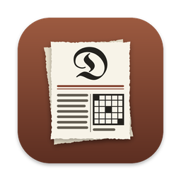
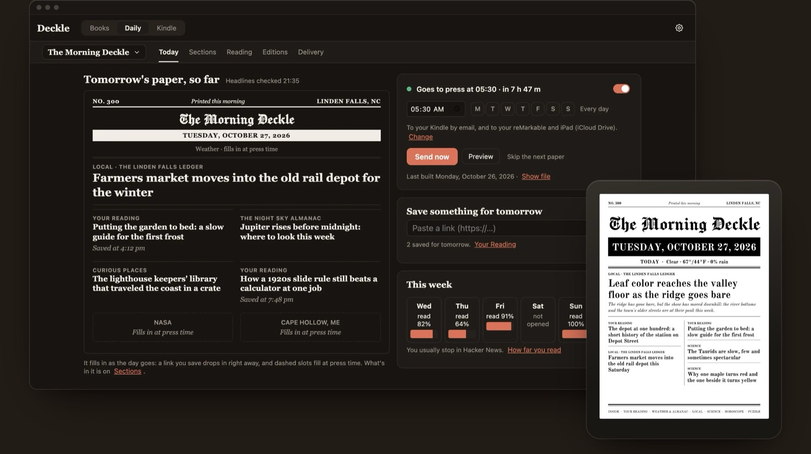
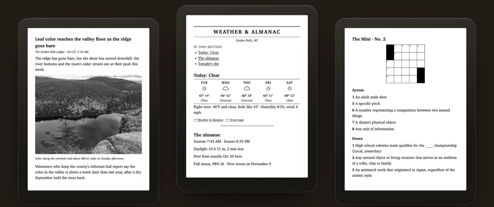
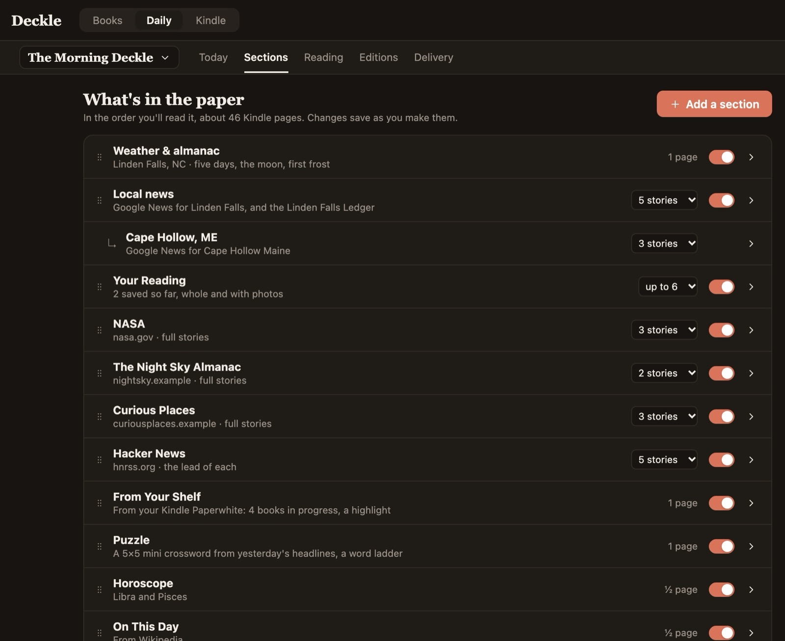
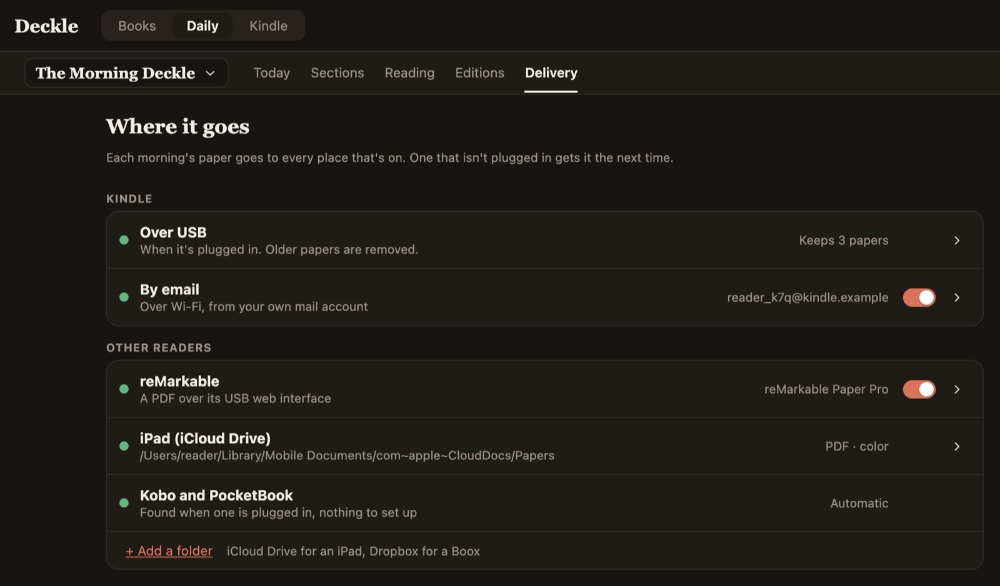
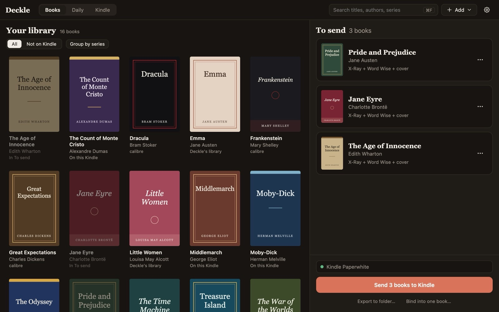
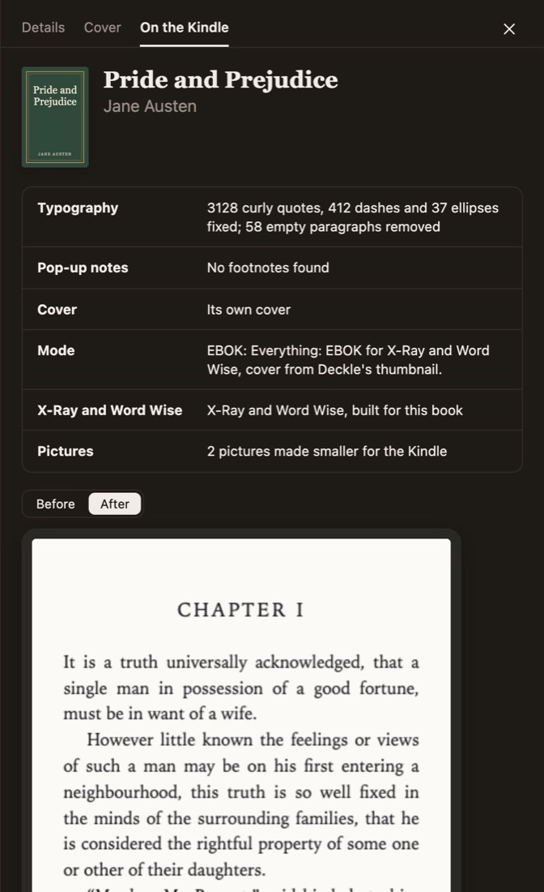
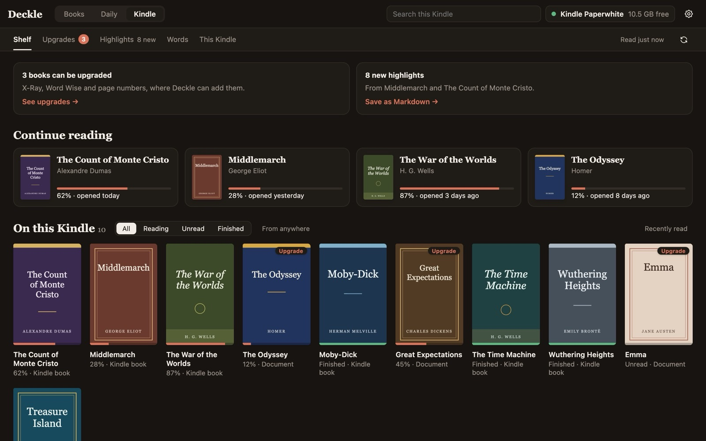
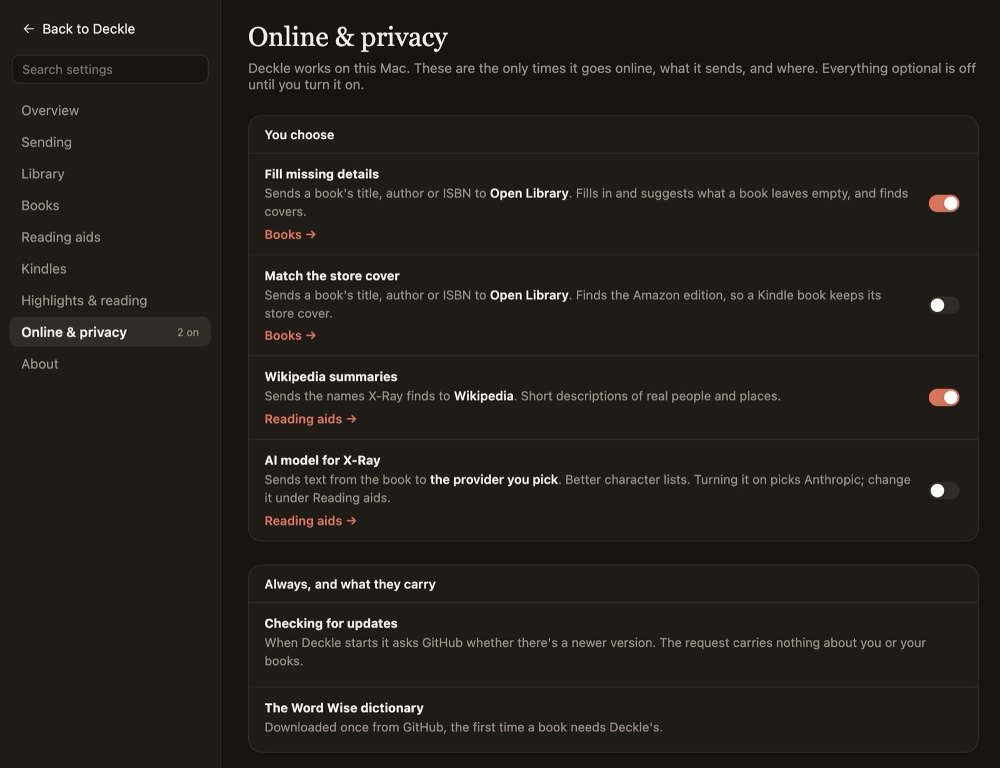

<p align="center">
  
</p>

<h1 align="center">Deckle</h1>

<p align="center">
  <strong>A morning paper for your e-ink reader, set on your own computer.</strong><br>
  And the books you own, finished like the store's.
</p>

<p align="center">
  <a href="https://github.com/CasaVargas/deckle/releases/latest"></a>
  <a href="https://github.com/CasaVargas/deckle/releases"></a>
  <a href="https://github.com/CasaVargas/deckle/actions/workflows/ci.yml"></a>
  <a href="LICENSE"></a>
</p>

<p align="center">
  <a href="https://github.com/CasaVargas/deckle/releases/latest"><b>Download for Mac or Windows</b></a>
  &nbsp;·&nbsp;
  <a href="#install">Install</a>
  &nbsp;·&nbsp;
  <a href="https://casavargas.app/deckle/">Website</a>
  &nbsp;·&nbsp;
  <a href="#docs">Docs</a>
</p>

<p align="center">
  
</p>

Every morning Deckle builds a real newspaper from your town's news and weather, your RSS feeds,
the topics you follow and the articles you saved, and has it waiting on your Kindle, Kobo,
PocketBook or reMarkable before you're up. It also turns the EPUBs, Word documents, PDFs and notes
you own into Kindle books that behave like store books: Enhanced Typesetting, a cover that stays,
real page numbers, X-Ray and Word Wise.

- **Local.** There's no Deckle server. The paper is fetched, set and kept on your machine. No
  account, no subscription, no telemetry, and [every network call is listed](#what-goes-online).
- **Any e-ink reader.** Kindle over USB or by email, Kobo as KEPUB, PocketBook as EPUB,
  reMarkable as a PDF to write on, and any folder for a Boox or an iPad.
- **Open source.** GPL-3.0. A Rust workspace with a Tauri app on top, and a
  [command line](#command-line) that does everything the app does.

The app has five tabs:

| Tab | What it's for |
|---|---|
| [**Daily**](#the-daily) | Your morning paper: what's in it, when it prints and where it goes |
| [**Books**](#books) | Your library and the queue: drop a book in, press **Send** |
| [**Cookbook**](#the-kitchen-book) | Recipes you save, kept as one book on your Kindle |
| [**Puzzles**](#puzzle-books) | Crosswords, sudoku and more, as books you solve in ink |
| [**Devices**](#your-devices) | What's on each reader: progress, highlights, upgrades, backups |

## The Daily

<p align="center">
  
  <br><sub>A demo edition built by Deckle's own code. The town and its stories are made up; the photo is public domain.</sub>
</p>

A feed reader is a pile of links. A paper has an order, a front page and a last page you can
finish. Deckle sets one each morning:

- **The front page is the cover.** Masthead, date, weather and the lead headlines, so your
  reader's library tile is today's paper. Ten masthead faces to choose from.
- **Whole stories, with photos.** Each story is pulled in full, the way Reader View does it, with
  photos turned grayscale for e-ink, or kept in color for a Colorsoft. Nothing opens a browser. A paywalled story runs as a brief.
- **Your town and what you follow.** Weather, local news for your town and any other place, each
  RSS or Atom feed as its own section, today's events from your calendars, and **interests**: a
  topic ("Rust", your team) searched every morning and kept only when a headline names it.
- **News in your language.** Each Google News search and topic can read another country's
  edition (Italy in Italian, Brazil in Portuguese, …), and On this day can come from another
  language's Wikipedia.
- **The reading you saved.** Save an article with the bookmarklet, a link dropped in the Inbox
  folder or an iPhone Shortcut, and it prints the next morning, whole.
- **The back pages.** A mini crossword whose theme answers are yesterday's headlines, a word
  search, a word ladder, an almanac, a horoscope, and On this day.
- **From Your Shelf.** The books you're in the middle of, a past highlight and the words you
  looked up this week, read from your own Kindle.
- **A paper per reader.** Each with its own sections, schedule, days and Kindle, and a
  large-print layout.
- **Papers you pay for.** Sign in to a BLOX (TownNews) paper you subscribe to and it prints in
  full. The password lives in the keychain.
- **The Morgue.** Every edition kept as a plain folder for a year, with full-text search, how far
  you read, and any old paper sent back to the reader.
- **An editor, if you want one.** Off by default. A model you choose, including one on your own
  computer, folds the same story from several feeds into one and writes short section briefs. Its
  text is labeled; the stories are never rewritten.

<table>
  <tr>
    <td width="50%"></td>
    <td width="50%"></td>
  </tr>
  <tr>
    <td><b>Sections.</b> One list, in the order you'll read it, saved as you go.</td>
    <td><b>Delivery.</b> Every place the paper goes. One that isn't plugged in gets it next time.</td>
  </tr>
</table>

Pick a time and the paper builds every morning; a Mac asleep at 5:30 builds it when it wakes. A
source that fails prints "unavailable today" and the paper still comes out. **Stop the presses**
skips a morning. Only the newest three papers stay on the reader. Deckle notices which sections
you actually reach and suggests changes, on this machine only.

Every setting is in [docs/daily.md](docs/daily.md).

## Books

<p align="center">
  
</p>

A book you load onto a Kindle yourself is second-class. Amazon's own Send to Kindle drops Enhanced
Typesetting, X-Ray and Word Wise; the cover often goes grey; there are no real page numbers.
calibre plugins and forum recipes fix each of these one at a time, and they conflict. Deckle runs
it all as one pipeline and picks the right trade-off for the Kindle that's plugged in. Drop the
books in, plug the Kindle in, press **Send**.

- **Enhanced Typesetting (KFX)**, with approximate page numbers.
- **Covers that stick.** On Kindles where it can, Deckle writes its own cover thumbnail and puts
  it back on every send.
- **X-Ray.** The people and terms in the book. A Kobo or PocketBook gets them as a Who's who page
  at the back.
- **Word Wise.** Hints from a Wiktionary-derived English lexicon.
- **Recaps, without spoilers.** Off by default. With an AI model, a short labeled recap at the
  end of each chapter, a Summary page at the back, and a Previously page for a later book in a
  series.
- **Cleanups.** Typography fixes, footnotes as pop-up notes, language tags repaired, and missing
  details filled from Open Library if you turn that on.
- **Book styles.** Novel, Academic or Manual, per book.

<table>
  <tr>
    <td width="38%"></td>
    <td>
      <b>Before you send.</b> Click any book to see what Deckle will do to it: the fixes counted,
      the cover and the mode, and why. Then the first page of chapter one as a Kindle sets it,
      <b>Before</b> and <b>After</b>.<br><br>
      The drawer also edits the book's details (title, authors, series, description, tags), with
      Open Library suggesting what's missing, and lets you swap the cover.
      <b>Change title &amp; author for this send…</b>, on a queued book's menu, changes them in the
      copy that's sent and leaves the file you added as it is.
    </td>
  </tr>
</table>

**If you can read it, you can send it.**

| You have | What Deckle does |
|---|---|
| EPUB | Cleaned up and finished like a store book. A finished `.kfx` is sent as it is |
| Word, OpenDocument, RTF, FictionBook, plain text | Headings become the contents; tables, pictures and footnotes come through |
| DRM-free Kindle files (`.mobi`, `.azw3`) | Rebuilt as real KFX. DRM-protected files are refused, never decrypted |
| PDF | Reflowed: columns in order, a paper's first page included; running heads dropped; equations as pictures. A scan goes as page pictures. `deckle send` copies one as it is, to write on with a Scribe |
| Markdown, or a folder of notes | One book, a chapter per file |
| Comics, manga, picture books (`.cbz`, `.cbr`, fixed-layout EPUB) | Pages kept as they are, fitted to the reader's screen, right to left when the book is |
| A web address or a saved page | The article, as a book |
| Several of the above | Bound into one book, in your order |

**The library is a plain folder** (`Author/Title/` plus a `deckle.json`), no database. Deckle
shows it beside the queue with covers, groups series with the gaps called out, searches across
your library, your Kindles and past sends, and tells you which books on a Kindle it could now
build better.

Every format, and the book styles, are in [docs/books.md](docs/books.md). Files over
[these sizes](docs/books.md#size-limits) are refused.

## The Kitchen Book

Recipes you keep become one book, with its own cover, chapters and an index by ingredient.

- **Paste a recipe's address** on the **Cookbook** tab, or drop a link file, and see it before it
  goes in the book. Deckle files it in a chapter (Breakfast, Mains, Desserts…) with the site's
  photo made for e-ink.
- **Save from anywhere.** A *Save recipe* bookmarklet, or a link dropped in the Inbox's `Recipes`
  folder, which is how an iPhone Shortcut saves one.
- **Every Kindle gets it** as one book, brought up to date the next time it's plugged in after
  you add a recipe. Leave a Kindle out if you like.
- **Engravings of your dishes.** Off by default. An image service you choose, with your own key,
  draws each recipe as an old-fashioned engraving.

Details are in [docs/cookbook.md](docs/cookbook.md).

## Puzzle books

The **Puzzles** tab makes a book of crosswords (5×5 to 15×15), word searches, sudoku, word
ladders, cryptograms, nonograms or mazes, as a PDF that takes pen ink on a Kindle Scribe.

- **Sized for the reader.** A Scribe, a reMarkable, an iPad or A5 paper.
- **Themed on what you follow.** A crossword or word search can take its words from the week's
  paper, your interests, the words you looked up on the Kindle, your cookbook, your own list, or
  a subject the AI writes about.
- **Clues your way.** With the AI on, clues can be rewritten as trivia, cryptic, or for a kid.
- **Previewed, and repeatable.** The first page is shown before you make the book, and **Your
  books** lists every one you've made, so **Make again** gives the same book.
- **On an iPad.** The same book as data its reader solves, Sunday's book alongside Sunday's
  paper, and the count of what was solved comes back to the tab.

Details are in [docs/puzzle-books.md](docs/puzzle-books.md).

<a id="your-kindle"></a>

## Your devices

The **Devices** tab has a page for each Kindle and each other reader that's connected: a Kobo or
PocketBook plugged in, or a reMarkable over its USB web interface or SSH.

<p align="center">
  
</p>

- **A shelf you can read.** Every book on the reader with its progress and when you last opened
  it, filtered and searchable.
- **Upgrade what's already there.** Books calibre or anything else put on the Kindle are matched
  to their originals on your computer and rebuilt with Enhanced Typesetting, page numbers, X-Ray
  and Word Wise. The Kindle's copy is kept, so **Put back** undoes it. Store books and anything
  with DRM are left alone.
- **Make room, back up, restore.** Space split by why: finished books, second copies, old papers.
  Copy every DRM-free book with its highlights and reading position to your computer, and put a
  backup on any Kindle later.
- **Kobo, PocketBook and reMarkable.** Each gets every book, how far you've read it, the space
  left, **Remove** and **Back up**. Books bought from Kobo are listed but never deleted.
- **Edit a book's details where it is.** Title, authors and series on a Kindle, Kobo or
  PocketBook; a document's name on a reMarkable over SSH.
- **Highlights out.** One Markdown file per book in a folder you choose, sideloaded books
  included, and KOReader's highlights too.
- **Words to Anki.** The words you looked up, as flashcards with the sentence you met them in.
- **Several Kindles in one home.** Name each Kindle, then send a book to *Mom's Kindle* even when
  it's in her bag: it waits until that Kindle connects.

The details, reader by reader, are in [docs/readers.md](docs/readers.md#the-devices-tab).

## KOReader and calibre

KOReader runs on jailbroken Kindles, Kobos, PocketBooks, Boox tablets and reMarkables. Deckle
reads from it, serves it and manages it, and calibre stays your library of record.

- **The paper over Wi-Fi.** Deckle serves an OPDS catalog on your home network, behind a password
  you choose. KOReader downloads today's paper and your books from it, and its own progress sync,
  pointed at the same address, reports how far you read.
- **The Deckle plugin** fetches the morning paper by itself when the reader wakes.
- **Plugins, from Deckle.** **Settings → KOReader** installs, updates, removes and rolls back the
  reader's plugins, from a zip, a folder, a GitHub release or a reviewed store pinned by hash.
- **calibre's wireless connection, answered by Deckle.** Tap *Connect* in KOReader and Deckle
  appears as calibre would, with no calibre running.
- **Reading data back into calibre.** Progress, rating and highlights into calibre columns you
  choose, through calibre's own `calibredb`. Off by default, with a preview.
- **Shelves from calibre.** A tag, series, author or saved search becomes a shelf on a Kobo or a
  collection in KOReader.

Setup for each is in [docs/daily.md](docs/daily.md#koreader-over-wi-fi).

## What each reader gets

| | Kindle | Kobo | PocketBook | reMarkable | KOReader (Wi-Fi) | A folder |
|---|---|---|---|---|---|---|
| The paper | KFX over USB, or by email | KEPUB | EPUB | PDF to write on | EPUB or KEPUB | EPUB, KEPUB or PDF |
| Books | KFX, cover, page numbers | clean KEPUB | clean EPUB | EPUB | EPUB | KFX |
| X-Ray and Word Wise | yes | Who's who page | Who's who page | Who's who page | – | – |
| AI recaps | yes | yes | yes | yes | – | yes |
| Comics and manga | AZW3 | fixed-layout EPUB | fixed-layout EPUB | image PDF | – | AZW3 |
| Puzzle books | PDF; ink on a Scribe | – | – | PDF | – | PDF, or data for an iPad |
| The Kitchen Book | yes | – | – | – | – | EPUB |
| How far you read | yes | with KOReader | with KOReader | – | yes | – |
| On the Devices tab | yes | yes | yes | yes | – | – |

A Kindle Scribe can take the paper as a PDF its pen writes on. Kindle books and the Kindle's
paper need Kindle Previewer, which runs on Mac and Windows; a Kobo, PocketBook or reMarkable
needs no Previewer. The whole table, with the Scribe and email on their own, is in
[docs/readers.md](docs/readers.md).

## Install

1. **Download Deckle** from [Releases](https://github.com/CasaVargas/deckle/releases/latest):
   - **macOS 14+**, Apple silicon or Intel: the `.dmg`, signed and notarized.
   - **Windows 11**: the `-setup.exe` (per-user, no admin), code-signed. A new certificate can still
     trigger SmartScreen: **More info → Run anyway**.
   - **Linux**: the command line only, as `deckle-<version>-<target>.tar.gz` for x86_64 or aarch64
     (needs glibc 2.35+ and `libdbus-1-3`), or the [container](docs/docker.md), which serves the
     app to your browser on port 8080. On Unraid, search for **Deckle** in the Apps tab.
2. **For Kindle books, install [Kindle Previewer 4](https://kdp.amazon.com/en_US/help/topic/G202131170)**
   (free, from Amazon). It's the only thing that produces Enhanced Typesetting. Deckle drives it and
   doesn't bundle it. The paper on a Kobo, PocketBook or reMarkable doesn't need it.
3. **Set up your paper** on the Daily tab and turn on the morning schedule. For books, plug in the
   Kindle, drop files on the window and press **Send**.

Deckle updates itself: when a new version is out, the footer says so, and **Settings → About →
Update** installs it. Coming from 0.2.x, install the latest by hand once; on Windows, uninstall a
0.2.x `.msi` first.

Quit calibre, Android File Transfer and Amazon's Send to Kindle first. Only one program at a time
can talk to an MTP Kindle (Scribe, Colorsoft, Paperwhite 2024).

## What goes online

Converting and sending a book is offline. Deckle goes online only for:

| What | When | Default |
|---|---|---|
| Update check (`latest.json` from this repo's Releases); the update itself only when you click Update | each launch | on |
| Word Wise dictionary (12 MB, from this repo's Releases) | once, the first time a book gets Word Wise | on |
| The Daily's sources, and optional email delivery through your own SMTP account | each edition | off until you set it up |
| An AI model for X-Ray, chapter recaps, the Daily's editor, or a puzzle book's clues and theme; nowhere online when it runs on this computer | each book, edition or puzzle book that uses it | off |
| The local model itself, downloaded by Ollama | when you press **Download** in Settings → AI, or run `deckle llm pull` | only when you ask |
| Wikipedia summaries for X-Ray | each book with features | off |
| Amazon edition lookup (Open Library) | books for MTP Kindles | off |
| Metadata fill (Open Library) | each book sent | off |
| The KOReader plugin store (GitHub) | when you open it, search it or install from it | only when you ask |
| A recipe's page, for the Kitchen Book | when you save the recipe | only when you ask |
| Engravings for the Kitchen Book, from an image service you choose, with your own key | each recipe you ask it to draw | off |

<p align="center">
  
</p>

The app lists all of it on one page, **Settings → Online & privacy**. A book sent with features
carries an ASIN, so the Kindle itself may ask Amazon about it. That's the Kindle, not Deckle.
Sending cover-first avoids it.

## Command line

Everything the app does, from a terminal:

```sh
deckle digest run --to device                     # build today's paper and send it
deckle digest schedule --at 05:30                 # every morning
deckle run book.epub --to device                  # convert, enrich, send
deckle run manga.cbz --to remarkable              # a comic, fitted to the reMarkable's screen
deckle puzzles crossword --to device --size 13    # a book of crosswords to solve in ink
deckle cookbook add https://…                     # keep a recipe
deckle kindle upgrade --dry-run                   # books on the Kindle that Deckle could build better
deckle highlights export --to ~/Notes/Reading     # one Markdown file per book
```

The rest is in [docs/cli.md](docs/cli.md), and `deckle --help`.

## Docs

| | |
|---|---|
| [The Daily](docs/daily.md) | Every setting of the paper, delivery to each reader, KOReader, calibre, the AI editor |
| [Books](docs/books.md) | Every format Deckle takes, and the book styles |
| [The Kitchen Book](docs/cookbook.md) | Saving recipes, illustrations, delivery |
| [Puzzle books](docs/puzzle-books.md) | Each kind of puzzle, themes, the iPad |
| [What each reader gets](docs/readers.md) | The whole table, how the paper reaches each reader, the Devices tab |
| [Devices checked](docs/devices.md) | What's been verified on real hardware |
| [Command line](docs/cli.md) | The commands, with examples |
| [The container](docs/docker.md) | Deckle on Linux, Docker and Unraid |
| [How it works](docs/how-it-works.md) | KPF to KFX, covers against features, MTP on macOS, X-Ray, Word Wise |
| [Translating](docs/translating.md) | Fix a line or add a language |

## Status

Early, and moving fast. The whole pipeline works from the app and the CLI and is tested against
fixtures and simulated devices. On real hardware it's verified on a **Kindle Scribe (2024)**,
comics included, and a **Kindle Paperwhite**; KOReader and the calibre connection are partly
checked on those two. Other Kindles are pending, and Kobo, PocketBook and reMarkable, their pages
on the Devices tab included, are tested only against simulated devices so far. Newer pieces have no
device check recorded yet: the paper and puzzle books as PDFs to write on a Scribe, and editing a
book's details on a reader. Results per device are in [docs/devices.md](docs/devices.md), and bug
reports with your model and firmware are very welcome.

On Linux, the Daily runs headless in a [container](docs/docker.md) (Docker, or Unraid's Apps tab); Kindle books
can't be converted there, because Kindle Previewer only runs on Mac and Windows. What's next is on the
[roadmap](https://github.com/CasaVargas/deckle/issues?q=is%3Aopen+label%3Aroadmap).

## In your language

Deckle's own words come in English, Deutsch, Español, Français, Italiano and Português (Brasil),
under Settings → About → Language; so far the welcome is translated, and the rest of the app
follows one area at a time. Each language starts as an AI draft that the people who read it
correct: [docs/translating.md](docs/translating.md) says how to fix a line or add a language.

## Build from source

Rust (stable, 1.85+), Node 22, pnpm. Kindle book conversion needs macOS or Windows.

```sh
git config core.hooksPath .githooks                # once: fmt + clippy before every push
cargo nextest run --workspace                       # tests (cargo install cargo-nextest; `cargo test` works too)
cargo nextest run -p deckle-core pipeline::           # a crate's tests are one `it` binary: filter by module
cd apps/desktop && pnpm install && pnpm tauri dev   # app with hot reload
pnpm tauri build                                   # installers in target/release/bundle
```

The app ships with the PDFium library it needs; a source build of the CLI gets it with
`tools/fetch-pdfium.sh` (or `DECKLE_PDFIUM`), once per machine: every checkout and worktree
finds that copy. Releases: [docs/release.md](docs/release.md). Word
Wise database builder: [data/wordwise/README.md](data/wordwise/README.md).

## Built with AI

Deckle is developed with AI assistance (Claude Code). Every feature starts as a written spec and
plan in [docs/superpowers/](docs/superpowers/), and what the AI writes is reviewed and tested,
against fixtures and real Kindles, before it merges.

## Credits

Deckle builds on research and code from the MobileRead community: jhowell's KFX Input/Output and
kfxlib, jloutsch's kfxgen, xxyzz's WordDumb and Proficiency, seapy's kindle-cli, calibre's
Kindle driver, the MobileRead wiki's MOBI format notes, and KindleUnpack (GPL-3), whose KF8 path
Deckle's AZW3 rebuild follows. Word Wise definitions come from Wiktionary via kaikki.org (CC BY-SA
4.0), word frequencies from wordfreq (CC BY-SA 4.0). PDFs are read with PDFium (BSD-3-Clause),
built by bblanchon/pdfium-binaries. The paper's weather comes from Open-Meteo and On this day from
Wikipedia; the masthead faces are under the SIL Open Font License.

Kindle Previewer is Amazon's and is never bundled. Kindle is a trademark of Amazon.com, Inc.;
Kobo, PocketBook, reMarkable and Boox belong to their makers. Deckle is not affiliated with any of
them.

## Made by Casa Vargas

Deckle is free and stays free. It's made by one developer at [Casa Vargas](https://casavargas.app/),
an indie studio in North Carolina. If you like it, the paid apps are what keep it that way; each is a
one-time purchase, never a subscription:

- **[Beltr](https://beltr.app/)** · $19.99 once · Karaoke from the music you already own. Every phone
  in the room becomes a mic. Mac, Windows, Linux; five songs free to try.
- **[OneScribe Pro](https://getonescribe.app/)** · $9.99 once · A document scanner that reads what it
  scans, with the AI on your device. iPhone and iPad; free to scan.

Everything else, including what's in the workshop, is at [casavargas.app](https://casavargas.app/).
The same card is in the app under **Settings → About**.

## License

GPL-3.0-or-later. See [LICENSE](LICENSE).
