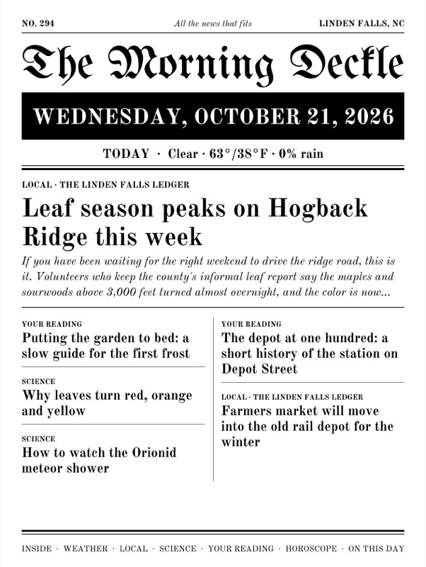
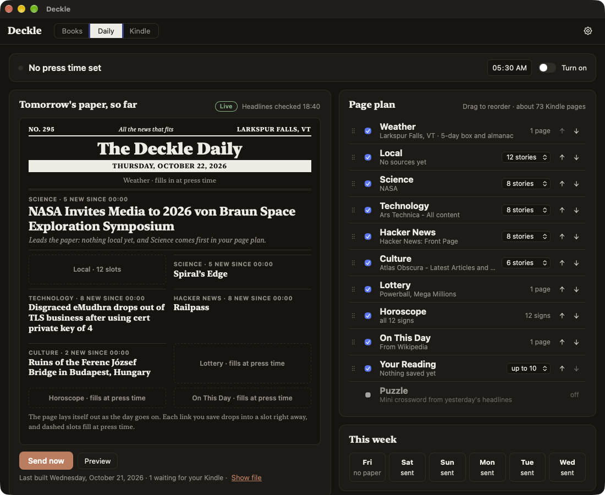
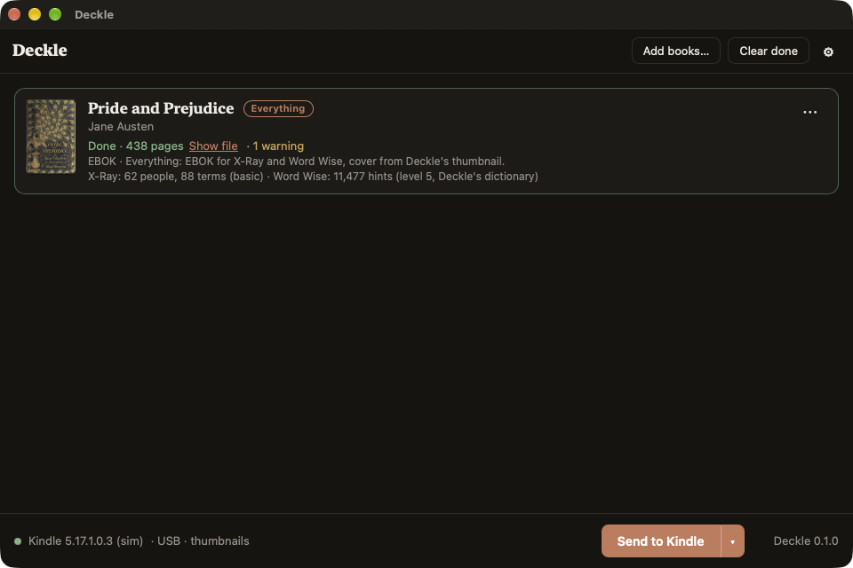

# Deckle

[](https://github.com/CasaVargas/deckle/releases/latest)
[](https://github.com/CasaVargas/deckle/releases)
[](https://github.com/CasaVargas/deckle/stargazers)
[](https://github.com/CasaVargas/deckle/actions/workflows/ci.yml)
[](LICENSE)

Deckle turns EPUBs you own into Kindle books that behave like store books, and puts them on your
Kindle over USB: Enhanced Typesetting, a cover that shows, real page numbers, X-Ray and Word Wise.

Desktop app for macOS and Windows, plus a CLI. Written in Rust (Tauri for the UI). GPL-3.0. No
account, no subscription, no telemetry.

It also prints you a morning paper. The Deckle Daily (preview) builds an edition on your machine
from your town's weather and news, your RSS feeds and the articles you saved, with a generated
front page as its cover, and delivers it when the Kindle connects. Details in
[docs/daily.md](docs/daily.md).







## Why

A sideloaded EPUB is a second-class book on a Kindle. Amazon's own conversion through Send to
Kindle drops Enhanced Typesetting, X-Ray and Word Wise. calibre plugins and forum recipes fix
each of these one at a time, and they conflict: the trick that turns on X-Ray gives you a grey
cover on a 2024 Scribe. Deckle does all of it in one pipeline and picks the right tradeoff for
the Kindle that's plugged in.

## Install

1. Install [Kindle Previewer 4](https://kdp.amazon.com/en_US/help/topic/G202131170) (free, from
   Amazon). It's the only thing that produces Enhanced Typesetting. Deckle drives it and doesn't
   bundle it.
2. Download Deckle from [Releases](https://github.com/CasaVargas/deckle/releases):
   - **macOS 14+**, Apple Silicon or Intel: `.dmg`, signed and notarized.
   - **Windows 11**: `-setup.exe` (per-user, no admin), code-signed. A new certificate can still
     trigger SmartScreen: **More info → Run anyway**.
3. Plug in the Kindle, drop EPUBs on the window, press **Send to Kindle**.

From 0.3.0 on, Deckle updates itself: when a new version is out, the footer says so, and
**Settings → About → Update** installs it. Coming from
0.2.x, install 0.3.0 by hand once; on Windows, uninstall a 0.2.x `.msi` first.

Quit calibre, Android File Transfer and Amazon's Send to Kindle first. Only one program at a time
can talk to an MTP Kindle (Scribe, Colorsoft, Paperwhite 2024).

## Status

Early. The whole pipeline works from the app and the CLI and is tested against fixtures and a
simulated mass-storage Kindle. On real hardware it's been verified on a Kindle Scribe (2024) and
a Kindle Paperwhite (over USB mass storage); other models are pending. Results per device are in
[docs/devices.md](docs/devices.md). Bug reports with your model and firmware are very welcome.

## Being built right now

On `main` and not in the latest release (0.3.1) yet; it ships in the next one. The first item is
the screenshot above.

- **Tomorrow's paper, so far.** The Daily tab opens on the next edition: a press bar with a
  countdown and **Stop the presses**, a live sketch of the front page that fills in as you save
  articles and your feeds post, a page plan you drag to reorder, and the week's reads.
- **Local news for more places** ([#102](https://github.com/CasaVargas/deckle/issues/102)):
  a relative's town or a vacation spot gets its own local section.
- **A puzzle page:** a 5×5 mini crossword whose theme answers are yesterday's headlines, a word
  ladder, and yesterday's answers.
- **Weather & Almanac, Your Day, readership.** A five-day strip with sunrise, sunset, first frost,
  the moon and meteor showers; today's calendar events on the page; and which sections of the
  paper you actually reach.

- **From Your Shelf:** the books you're in the middle of, a past highlight and the words you
  looked up this week, drawn from your own Kindle.
- **The Morgue:** every edition kept in a plain folder, searchable, shown on the Daily tab as a
  month of front pages, and sendable to the Kindle again.
- **The paper on an iPad, or in any folder:** each morning's edition also goes to the folders you
  choose, as an EPUB with color photos if you like. An iCloud Drive folder reaches an iPad's
  Files app. No Kindle Previewer needed for it.
- **reMarkable, and a PDF paper:** the paper laid out as a PDF for a reMarkable's screen
  (crossword and all, to write on), uploaded over its USB web interface; the same PDF can go to
  an export folder for an iPad or a Boox. Not yet checked on a real tablet.
- **Kobo and PocketBook:** the paper, long reads and Inbox books go to a Kobo as KEPUBs and to a
  PocketBook as EPUBs; a Kobo's highlights export as Markdown, and From Your Shelf reads it. No
  Previewer needed. Not yet checked on real devices
  ([other readers design](docs/superpowers/specs/2026-10-23-other-readers-design.md)).

Designed, with a written plan, and waiting for code: **One Mac, many papers**
([#110](https://github.com/CasaVargas/deckle/issues/110)). The rest is on the
[roadmap](https://github.com/CasaVargas/deckle/issues?q=is%3Aopen+label%3Aroadmap).

## What it does

- **Enhanced Typesetting (KFX).** Previewer makes a KPF; Deckle packs it into the monolithic KFX
  a Kindle reads, with approximate page numbers.
- **Covers that stick.** On Kindles where it can, Deckle writes its own cover thumbnail and puts
  it back on every send.
- **X-Ray.** Finds the people and terms in the book. Optionally an LLM (Anthropic, or any
  OpenAI-compatible endpoint including local Ollama) writes spoiler-free descriptions, and
  Wikipedia adds summaries.
- **Word Wise.** Hints from a Wiktionary-derived English lexicon, pointed at the Kindle's own
  dictionary when it has one.
- **Markdown and notes folders.** A `.md`/`.markdown` file or flat folder becomes one book,
  with headings, tables, local images and links between notes. Chapters follow filename order.
  Add notes through the desktop picker or drop a folder; the library keeps a self-contained EPUB
  snapshot. See [Markdown import](docs/markdown.md) for supported syntax.
- **Other inputs.** `.docx`, `.txt`, web articles (a URL, `.webloc`/`.url`, or a saved `.html`)
  go through the same pipeline. A finished `.kfx` is sent as is.
- **Bind several files into one book.** EPUBs, Word documents, text files, PDFs and web
  articles become one book, in your order, each with its own entry in the contents: a course
  packet, a week of saved long reads, a report in pieces.
- **PDFs, reflowed.** A text PDF becomes a book that reflows: columns read in order, running
  heads and page numbers dropped, broken words joined, and tables, equations and figures kept as
  pictures. It's never as good as a real ebook, and the run says so. The app ships with the
  PDFium library it needs; a source build of the CLI gets it with `tools/fetch-pdfium.sh` (or
  `DECKLE_PDFIUM`). Scans aren't supported.
- **Accessibility checks.** Normalize language-tag spelling and fill missing chapter language
  attributes while preserving explicit languages. Inspection reports images missing alt text;
  existing descriptions and intentional empty alt attributes stay unchanged. This runs offline.
- **Optional cleanups.** Fill missing metadata from Open Library, fix typography, turn footnotes
  into pop-up notes.
- **Library.** A plain folder (`Author/Title/` plus a `deckle.json`), no database. Deckle can
  tell you which books on the Kindle it could now build better and re-send them.
- **Upgrade books Deckle didn't send.** Books calibre or anything else put on the Kindle are
  matched to their originals on your computer (your calibre library, read-only, or folders you
  name) and rebuilt with Enhanced Typesetting, page numbers, X-Ray and Word Wise. With no
  original, a DRM-free AZW3 is rebuilt from the Kindle's own copy, and checked before it
  replaces anything. The Kindle's copy is kept with its highlights and reading data, so an
  upgrade can be put back. Store books and anything with DRM are left alone.
- **Highlights out.** Highlights and notes from the Kindle's `My Clippings.txt`, as one Markdown
  file per book in a folder you choose (a notes vault, iCloud Drive). It covers sideloaded books,
  which Amazon's own export leaves out, and later exports only add what's new, so your own edits
  stay. The Kindle Scribe (2024) doesn't keep that file, and keeps its highlights where they
  can't be read over USB ([#99](https://github.com/CasaVargas/deckle/issues/99)).
- **Words to Anki.** The words you looked up on the Kindle, as a CSV of flashcards Anki imports:
  the word, a short definition, the sentence you met it in and the book.
- **The Deckle Daily (preview).** A morning newspaper built locally from weather, local news and
  your RSS feeds, with full article text and a generated front page as its cover, delivered when
  the Kindle connects. Details in [docs/daily.md](docs/daily.md).

## Network

Converting and sending a book is offline. Deckle goes online only for:

| What | When | Default |
|---|---|---|
| Update check (`latest.json` from this repo's Releases); the update itself only when you click Update | each launch | on |
| Word Wise dictionary (12 MB, from this repo's Releases) | once, the first time a book gets Word Wise | on |
| LLM descriptions for X-Ray | each book with features | off |
| Wikipedia summaries for X-Ray | each book with features | off |
| Amazon edition lookup (Open Library) | books for MTP Kindles | off |
| Metadata fill (Open Library) | each book sent | off |
| The Daily's sources, and optional email delivery through your SMTP account | each edition | off until you set it up |

A book sent with features carries an ASIN, so the Kindle itself may ask Amazon about it. That's
the Kindle, not Deckle. *Settings → Default mode → Cover first* avoids it.

## How it works

The interesting parts, with format notes in [docs/formats/](docs/formats/).

**KPF → KFX.** Kindle Previewer's CLI outputs a KPF: a zip around a SQLite database of Ion
fragments, with 1 KiB fingerprint records injected every MiB. A Kindle wants a monolithic KFX.
jhowell's kfxlib (GPL-3, part of the KFX Input calibre plugin) has the complete conversion.
Deckle's KFX writer is a Rust port of it, tested byte for byte against kfxlib's output, so no
Python is involved. Page numbers come from the same port (1,850 positions per page).

**Covers vs. features.** X-Ray and Word Wise only load for books marked **EBOK** with an ASIN.
An EBOK whose ASIN the store doesn't know shows a grey cover, and Amazon overwrites any cover
thumbnail with a "no image" file once the Kindle goes online. **PDOC** books always show their
embedded cover but get no X-Ray or Word Wise. So Deckle decides per Kindle:

| Kindle | What Deckle sends |
|---|---|
| Mass storage (`system/thumbnails` writable) | EBOK plus Deckle's own thumbnail, restored on every send: cover and features |
| MTP only (Scribe 2024, Colorsoft, Paperwhite 2024) | PDOC (cover wins), unless you give the book its real Amazon ASIN, in which case the Kindle fetches the store cover and keeps the features |
| Export to a folder | PDOC |

Amazon reuses a print ISBN-10 as that edition's ASIN, so Open Library is enough to find a
candidate without scraping Amazon. You can override the mode per book.

**MTP on macOS.** macOS has no MTP stack, so Deckle has a small PTP/MTP client over USB. Kindle
specifics: always the 32-bit ObjectInfo layout (libmtp switches layouts on the Kindle's nameless
root folders and every write then fails with `0xA806`), zero-length packets after full-packet
data phases, TransactionID 0 for OpenSession, and never create a `documents` folder.

**X-Ray** is a SQLite sidecar (`<book>.sdr/XRAY.entities.<ASIN>.asc`) in the schema WordDumb
reverse-engineered, with occurrences at KFX positions. Entities come from a heuristic tuned on
*Pride and Prejudice*: honorifics, speech verbs, stop lists, alias merging.

**Word Wise** is a sidecar that holds no text. `LanguageLayer.en.<ASIN>.kll` stores positions
and sense ids into a dictionary already on the Kindle (`system/kll/*.klld`). Deckle matches the
book against its own lexicon (174k senses, inflections mapped to lemmas, difficulty from
wordfreq) and points the hints at the Kindle's English dictionary. If the Kindle doesn't have
one, Deckle installs its own in the Chinese slot: set *Word Wise → Language → 中文* on the
Kindle; the hints are still English. Per-book proper-noun detection keeps "Darcy" from being
glossed as a unit of permeability.

MTP Kindles hide `system/`, so Word Wise there needs the Kindle's `kll.en.en.klld` copied to
`documents/deckle/` once (a jailbroken Kindle with KOReader can do it). Without it, Word Wise is
skipped and the book and X-Ray still ship.

## Command line

```sh
cargo build --release -p deckle-cli               # binary at target/release/deckle
deckle devices                                    # connected Kindles (mass storage and MTP)
deckle run book.epub --to device                  # convert, enrich, send
deckle run book.epub --to ./out --cde pdoc        # export to a folder, cover-first
deckle run book.epub --to device --cde ebok --asin B0XXXXXXXX   # real ASIN: store cover on MTP Kindles
deckle run book.epub --to device --cde ebok --llm anthropic     # X-Ray descriptions (ANTHROPIC_API_KEY)
deckle run book.epub --to device --cde ebok --llm openai \
  --llm-endpoint http://localhost:11434/v1 --llm-model llama3   # or a local model
deckle run book.epub --to device --word-wise-level 3            # hints for rarer words only
deckle run ./notes --to device                   # a flat Markdown folder, one note per chapter
deckle run notes.docx --to device                 # also .txt, .pdf, a URL, .webloc/.url/.html
deckle inspect book.epub --json                   # metadata, spine, TOC, warnings
deckle convert book.kpf -o book.kfx               # repackage an existing Previewer KPF

deckle library init ~/Books/Deckle                # keep a copy of everything you send
deckle library search le guin --json               # library, connected Kindles and past sends
deckle library list --series                      # grouped by series
deckle library reprocess --dry-run                # books Deckle could build better now
deckle kindle books                               # what's on the Kindle, and free space
deckle kindle upgrade --dry-run                   # books with an original here (calibre, folders)
deckle kindle put-back "Middlemarch.azw3"         # undo an upgrade: the kept copy goes back
deckle kindle backup                              # DRM-free books and their .sdr, to this computer
deckle kindle restore "…/kindle-backups/Kindle Scribe 2026-10-23T22-30"  # onto any Kindle
deckle highlights list                            # books with highlights, and what's new
deckle highlights export --to ~/Notes/Reading     # one Markdown file per book (folder remembered)
deckle words anki --to ~/Desktop/words.csv        # looked-up words as Anki cards (File → Import)
deckle bind a.pdf b.docx https://… --title "Pack"  # several files into one book, then `deckle run` it
deckle digest readership                          # how far you read the paper, per section
deckle digest readership apply 1                  # make suggested edit 1 to digest.toml
deckle digest shelf                               # what From Your Shelf would print now
deckle digest morgue search mill                  # every kept edition: list, search, show, send again
deckle digest next                                # tomorrow's paper so far: lead, page plan, this week
deckle digest stop                                # stop the presses: skip the next scheduled paper
```

`deckle --help` and `deckle <command> --help` list everything else.

## Build from source

Rust (stable, 1.85+), Node 22, pnpm. Conversion needs macOS or Windows.

```sh
git config core.hooksPath .githooks                # once: fmt + clippy before every push
cargo test --workspace
cd apps/desktop && pnpm install && pnpm tauri dev   # app with hot reload
pnpm tauri build                                   # installers in target/release/bundle
```

Releases: [docs/release.md](docs/release.md). Word Wise database builder:
[data/wordwise/README.md](data/wordwise/README.md). Design specs live in
[docs/superpowers/specs/](docs/superpowers/specs/).

## Built with AI

Deckle is developed with AI assistance (Claude Code). Features start as a written spec and plan in
[docs/superpowers/](docs/superpowers/), and what the AI writes is reviewed and tested, against
fixtures and real Kindles, before it merges.

## Credits

Deckle builds on research and code from the MobileRead community: jhowell's KFX Input/Output and
kfxlib, jloutsch's kfxgen, xxyzz's WordDumb and Proficiency, seapy's kindle-cli, calibre's
Kindle driver, the MobileRead wiki's MOBI format notes, and KindleUnpack (GPL-3), whose KF8
path Deckle's AZW3 rebuild follows. Word Wise definitions come from Wiktionary via kaikki.org (CC BY-SA 4.0), word
frequencies from wordfreq (CC BY-SA 4.0). PDFs are read with PDFium (BSD-3-Clause), built by
bblanchon/pdfium-binaries.

Kindle Previewer is Amazon's and is never bundled. Kindle is a trademark of Amazon.com, Inc.
Deckle is not affiliated with Amazon.

## License

GPL-3.0-or-later. See [LICENSE](LICENSE).
