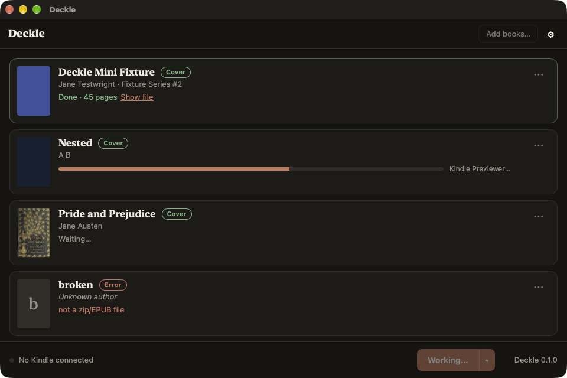

# Deckle

Turn any EPUB you own into a Kindle book that reads like one from the store, and put it on
your Kindle. Enhanced Typesetting, covers that actually show, X-Ray, Word Wise, real metadata.
One window: drop books, plug in Kindle, press go.

Mac and Windows. Open source (GPL-3.0-or-later). No account, no subscription, no telemetry.

Status: pre-alpha. The command line converts EPUB → KFX end to end (M1); the desktop app is a
shell (M0). See `docs/superpowers/specs/` for the design and `docs/superpowers/plans/` for the
build plan.

## Desktop app

`apps/desktop` is the Tauri app: drop EPUBs (or **Add books…**), each row shows cover, title,
author, series and a mode badge (**Cover** = PDOC, covers everywhere; **Features** = EBOK, for
X-Ray/Word Wise once M3 lands; **Error** with the reason). **Send to Kindle** runs the pipeline
book by book with per-stage progress; the split button exports to a folder instead. The row menu
overrides the mode per book, shows the full report, or removes the row. Settings (gear) hold the
Kindle Previewer path, default mode and page numbers; the M2–M4 options are visible but inert.

```sh
cd apps/desktop && pnpm install && pnpm tauri dev                 # develop
./target/debug/deckle-desktop --export-to ./out a.epub b.epub      # open books and convert at once
```



## Command line

```sh
cargo build --release -p deckle-cli            # binary at target/release/deckle
deckle devices                                 # connected mass-storage Kindles
deckle run book.epub --to device --pages auto  # inspect → normalize → Previewer → KFX → Kindle
deckle run book.epub --to ./out --cde pdoc     # export to a folder instead
deckle inspect book.epub --json                # metadata, spine, TOC, warnings
deckle convert book.kpf -o book.kfx --asin B0XXXXDECK   # repackage an existing Previewer KPF
```

`--cde pdoc` (default) shows covers on every Kindle; `--cde ebok` is what X-Ray and Word Wise
will need (M2+). `--pages auto` adds approximate page numbers like the store does.

The KFX writer is a Rust port of the GPL-3 kfxlib conversion path and is tested byte for byte
against kfxlib's output (`fixtures/`).

## Why

Sideloaded EPUBs are second-class citizens on a Kindle. Every fix exists somewhere as a
Calibre plugin or a forum recipe, and they fight each other. Deckle is the one tool that does
all of it and resolves the conflicts well by default.

## Requirements

- [Kindle Previewer 4](https://kdp.amazon.com/en_US/help/topic/G202131170) (Amazon's free
  tool; Deckle detects it, never bundles it). This is the only external dependency.
- A Kindle. Tested devices and firmware are listed in `docs/devices.md`.

## Credits

Deckle stands on research and code from the MobileRead community: jhowell's KFX Input/Output
and kfxlib, jloutsch's kfxgen, xxyzz's WordDumb, seapy's kindle-cli. Word Wise data derives
from Wiktionary (CC BY-SA 3.0).
