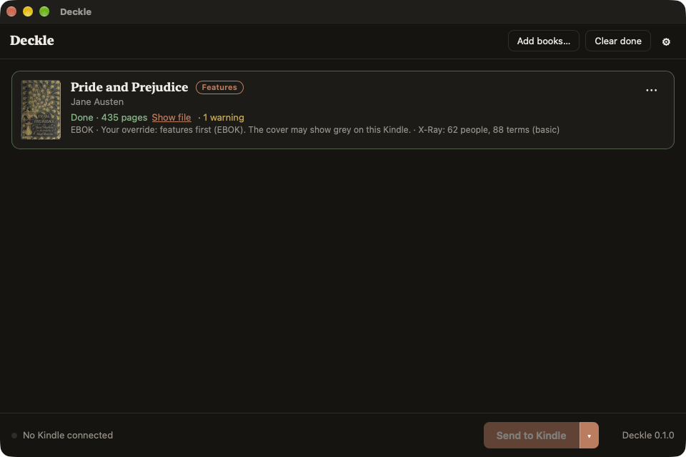

# Deckle

Turn any EPUB you own into a Kindle book that reads like one from the store, and put it on
your Kindle. Enhanced Typesetting, covers that actually show, X-Ray, Word Wise, real metadata.
One window: drop books, plug in Kindle, press go.

Mac and Windows. Open source (GPL-3.0-or-later). No account, no subscription, no telemetry.

Status: pre-alpha. EPUB → KFX with Enhanced Typesetting and page numbers (M1), the cover rule
with thumbnails, Amazon edition matching and MTP delivery (M2), X-Ray sidecars (M3) and Word Wise
(M4) work from the command line and the desktop app. Shipping (M5) is next. See `docs/superpowers/specs/`
for the design and `docs/superpowers/plans/` for the build plan.

## Desktop app

`apps/desktop` is the Tauri app: drop EPUBs (or **Add books…**), each row shows cover, title,
author, series and a mode badge (**Cover** = PDOC, covers everywhere; **Features** = EBOK with
X-Ray; **Everything** = EBOK plus a Deckle-written cover thumbnail; **Error** with the reason).
**Send to Kindle** runs the pipeline book by book with per-stage progress; the split button
exports to a folder instead. The result line says what shipped and why, and
`X-Ray: 62 people, 88 terms (basic) · Word Wise: 11,477 hints (level 5, Deckle's dictionary)`
when sidecars went along. The row menu overrides the mode
per book, shows the full report, or removes the row. Settings (gear) hold the Kindle Previewer
path, default mode, page numbers, Amazon matching, the X-Ray toggle, the LLM provider / model /
endpoint / key, the Wikipedia opt-in, and Word Wise on/off with its hint level.

```sh
cd apps/desktop && pnpm install && pnpm tauri dev                 # develop
./target/debug/deckle-desktop --export-to ./out a.epub b.epub      # open books and convert at once
./target/debug/deckle-desktop --send a.epub                         # open and send to the first Kindle
```





## Command line

```sh
cargo build --release -p deckle-cli            # binary at target/release/deckle
deckle devices                                 # connected mass-storage Kindles
deckle run book.epub --to device --pages auto  # inspect → normalize → Previewer → KFX → Kindle
deckle run book.epub --to ./out --cde pdoc     # export to a folder instead
deckle run book.epub --to device --cde ebok --llm anthropic   # X-Ray with LLM descriptions (ANTHROPIC_API_KEY)
deckle run book.epub --to ./out --cde ebok --llm openai --llm-endpoint http://localhost:11434/v1 --llm-model llama3
deckle run book.epub --to ./out --cde ebok --wikipedia       # Wikipedia summaries for places and things
deckle run book.epub --to ./out --xray off                   # no X-Ray sidecar
deckle run book.epub --to device --word-wise-level 3         # Word Wise hints for rarer words only
deckle run book.epub --to device --word-wise off             # no Word Wise sidecar
deckle inspect book.epub --json                # metadata, spine, TOC, warnings
deckle convert book.kpf -o book.kfx --asin B0XXXXDECK   # repackage an existing Previewer KPF
```

`--cde auto` (default) applies the cover rule: mass-storage Kindles get EBOK plus a Deckle-written
cover thumbnail (restored on every send, defeating Amazon's "no image" overwrite); MTP-only
Kindles and folder exports get PDOC so the cover always shows. `--cde pdoc|ebok` overrides it,
`--match` looks up an Amazon edition on Open Library when an MTP Kindle needs a real ASIN, and
`--pages auto` adds approximate page numbers like the store does. `deckle devices` lists both
mass-storage and MTP Kindles.

## Word Wise

EBOK books get a Word Wise sidecar. The first one downloads Deckle's own dictionary (about 12 MB,
built from Wiktionary by `data/wordwise`, cached). Hints point at the Kindle's own English Word
Wise dictionary when it has one, so they look like a store book's. A Kindle without it gets
Deckle's dictionary, installed once in the Chinese slot: set *Word Wise → Language* to 中文 on the
Kindle; the hints are English. Deckle never replaces Amazon's dictionaries. Details:
`docs/formats/wordwise.md`.

The KFX writer is a Rust port of the GPL-3 kfxlib conversion path and is tested byte for byte
against kfxlib's output (`fixtures/`).

## Why

Sideloaded EPUBs are second-class citizens on a Kindle. Every fix exists somewhere as a
Calibre plugin or a forum recipe, and they fight each other. Deckle is the one tool that does
all of it and resolves the conflicts well by default.

## Requirements

- [Kindle Previewer 4](https://kdp.amazon.com/en_US/help/topic/G202131170) (Amazon's free
  tool; Deckle detects it, never bundles it). This is the only external dependency.
- A Kindle. Tested devices and firmware are listed in `docs/devices.md`.

## Credits

Deckle stands on research and code from the MobileRead community: jhowell's KFX Input/Output
and kfxlib, jloutsch's kfxgen, xxyzz's WordDumb, seapy's kindle-cli. Word Wise data derives
from Wiktionary via kaikki.org (CC BY-SA 4.0) and word frequencies from wordfreq (CC BY-SA 4.0);
the Word Wise formats come from xxyzz's WordDumb and Proficiency.
