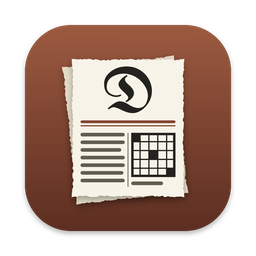
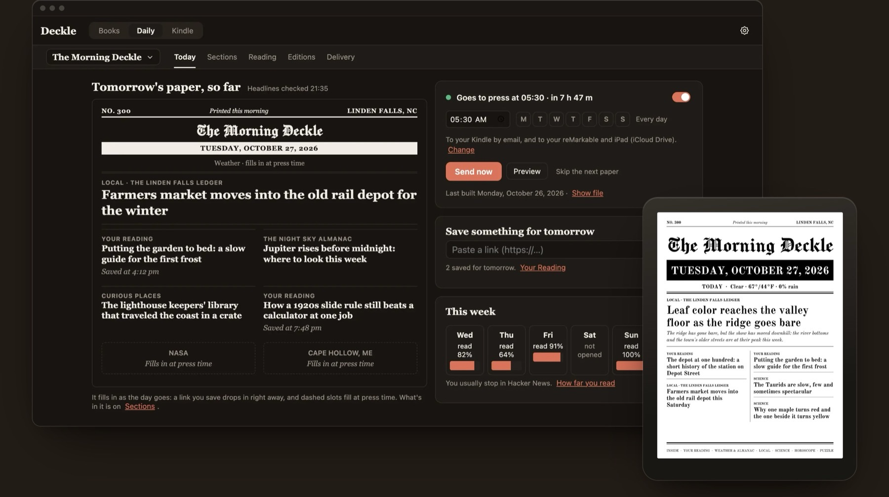
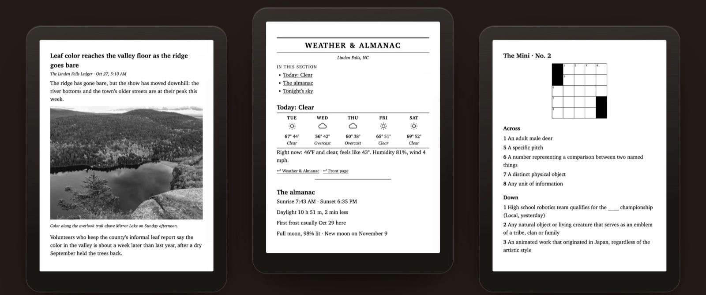
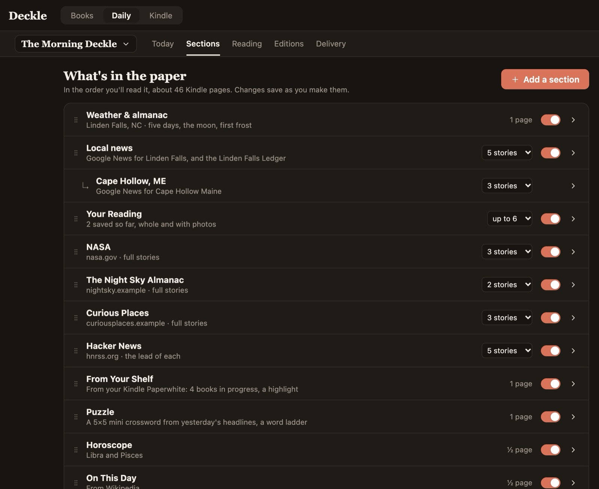
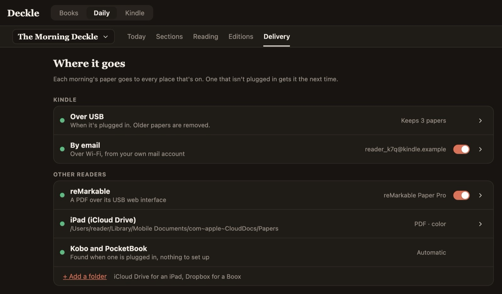
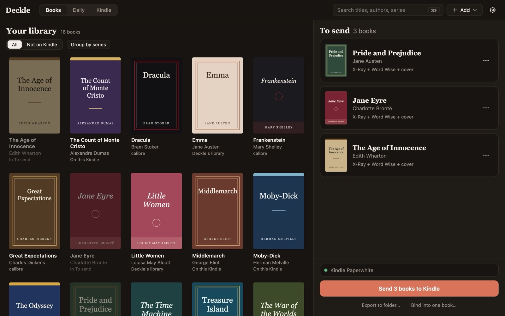
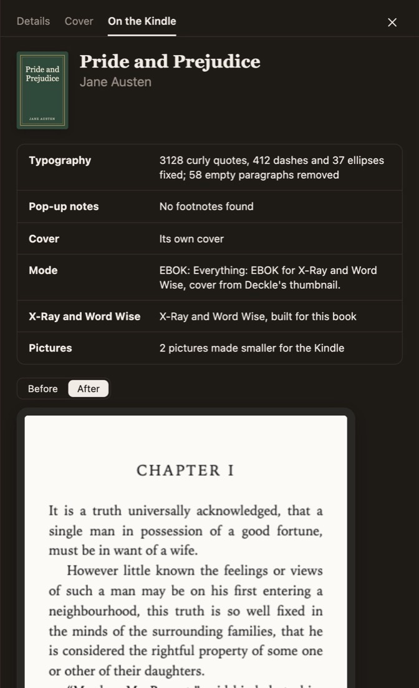
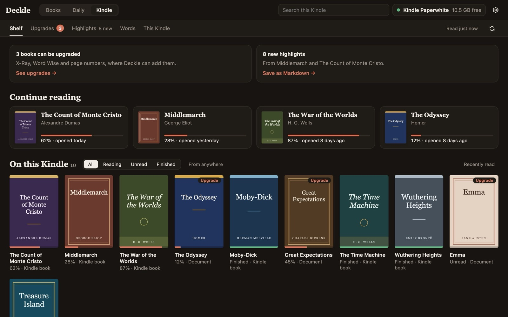
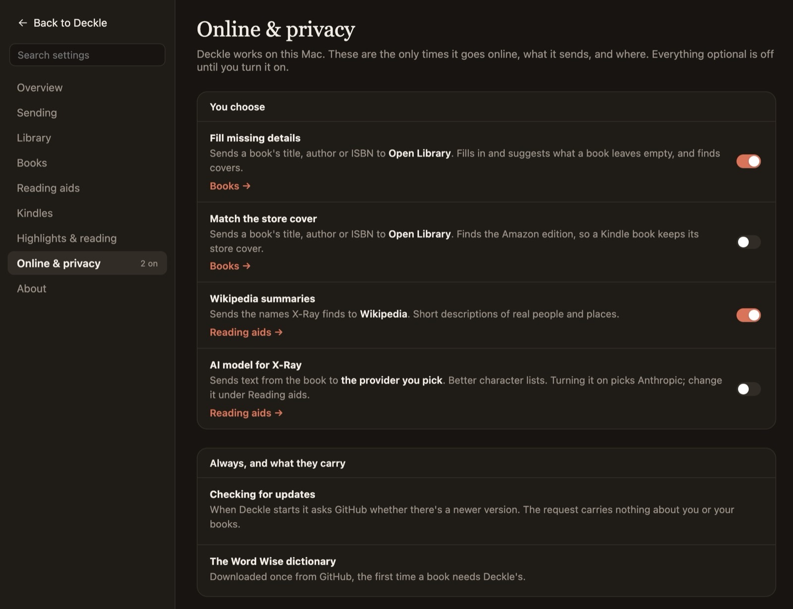

<p align="center">
  
</p>

<h1 align="center">Deckle</h1>

<p align="center">
  <strong>A morning paper for your e-ink reader, set on your own computer.</strong><br>
  And the books you own, finished like the store's.
</p>

<p align="center">
  <a href="https://github.com/CasaVargas/deckle/releases/latest"></a>
  <a href="https://github.com/CasaVargas/deckle/releases"></a>
  <a href="https://github.com/CasaVargas/deckle/actions/workflows/ci.yml"></a>
  <a href="LICENSE"></a>
</p>

<p align="center">
  <a href="https://github.com/CasaVargas/deckle/releases/latest"><b>Download for Mac or Windows</b></a>
  &nbsp;·&nbsp;
  <a href="https://casavargas.app/deckle/">Website</a>
  &nbsp;·&nbsp;
  <a href="docs/daily.md">The Daily, in full</a>
  &nbsp;·&nbsp;
  <a href="#how-it-works">How it works</a>
</p>

<p align="center">
  
</p>

Every morning Deckle builds a real newspaper from your town's news and weather, your RSS feeds,
the topics you follow and the articles you saved, and has it waiting on your Kindle, Kobo,
PocketBook or reMarkable before you're up. It also turns the EPUBs, Word documents, PDFs and notes
you own into Kindle books that behave like store books: Enhanced Typesetting, a cover that stays,
real page numbers, X-Ray and Word Wise.

- **Local.** There's no Deckle server. The paper is fetched, set and kept on your machine. No
  account, no subscription, no telemetry, and [every network call is listed](#what-goes-online).
- **Any e-ink reader.** Kindle over USB or by email, Kobo as KEPUB, PocketBook as EPUB,
  reMarkable as a PDF to write on, and any folder for a Boox or an iPad.
- **Open source.** GPL-3.0. A Rust workspace with a Tauri app on top, and a
  [command line](#command-line) that does everything the app does.

## The Daily

<p align="center">
  
  <br><sub>A demo edition built by Deckle's own code. The town and its stories are made up; the photo is public domain.</sub>
</p>

A feed reader is a pile of links. A paper has an order, a front page and a last page you can
finish. Deckle sets one each morning:

- **The front page is the cover.** Masthead, date, weather and the lead headlines, drawn fresh
  every morning. Your reader's library tile is today's paper. Ten masthead faces to choose from.
- **Whole stories, with photos.** Each story is pulled in full, the way Reader View does it, with
  photos turned grayscale for e-ink. Nothing opens a browser. A paywalled story stays a headline.
- **Your town and what you follow.** Weather from Open-Meteo, local news for your town and any
  other place you care about, each RSS or Atom feed as its own section, and **interests**: a topic
  ("Rust", your team) searched every morning and kept only when a headline actually names it.
- **The reading you saved.** Save an article with the bookmarklet, a link dropped in the Inbox
  folder or an iPhone Shortcut, and it prints the next morning, whole. A long read becomes its own
  book and rides along.
- **The back pages.** A 5×5 mini crossword whose theme answers are yesterday's headlines, a word
  ladder, an almanac with sunrise, the moon, the usual first frost and tonight's meteor shower, a
  horoscope, and On this day.
- **From Your Shelf.** The books you're in the middle of, a past highlight and the words you looked
  up this week, read from your own Kindle. It stays on your computer.
- **It learns, quietly.** It notices which sections you actually reach and suggests changes and new
  interests, on this machine only.
- **Papers for the whole house.** A paper per reader, each with its own sections, schedule, days
  and Kindle, and a large-print layout for big type.
- **Papers you pay for.** Sign in to a BLOX (TownNews) paper you subscribe to, such as The Pilot,
  and it prints in full as its own section group. The password lives in the keychain.
- **The Morgue.** Every edition kept as a plain folder for a year: a month of front pages, full-text
  search, how far you read, and any old paper sent back to the reader.
- **An editor, if you want one.** Off by default. Turned on, a model you choose (including a local
  one) folds the same story from several feeds into one, writes short section briefs and scores
  interest stories. Its text is labeled; the stories are never rewritten.

<table>
  <tr>
    <td width="50%"></td>
    <td width="50%"></td>
  </tr>
  <tr>
    <td><b>Sections.</b> One list, in the order you'll read it, saved as you go.</td>
    <td><b>Delivery.</b> Every place the paper goes. One that isn't plugged in gets it next time.</td>
  </tr>
</table>

Pick a time and the paper builds every morning; a Mac asleep at 5:30 builds it when it wakes. A
source that fails prints "unavailable today" and the paper still comes out. **Stop the presses**
skips a morning. Only the newest three papers stay on the reader.

| Reader | How the paper gets there |
|---|---|
| **Kindle** | Over USB when it's plugged in, or by email over Wi-Fi through your own mail account |
| **Kobo** | As a KEPUB, in a Deckle folder, the first time it's plugged in. Long reads and Inbox books too |
| **PocketBook** | The same, as EPUB |
| **reMarkable 2, Paper Pro, Paper Pro Move** | A PDF laid out for its screen, crossword and all, uploaded over its USB web interface. No account |
| **Boox, iPad, anything** | An export folder (iCloud Drive, Dropbox, a USB stick) gets each edition as EPUB or PDF, photos in color if you like |

Only Kindle books need Kindle Previewer. Every setting is in [docs/daily.md](docs/daily.md).

## Books

<p align="center">
  
</p>

A book you load onto a Kindle yourself is second-class. Amazon's own Send to Kindle drops Enhanced
Typesetting, X-Ray and Word Wise; the cover often goes grey; there are no real page numbers.
calibre plugins and forum recipes fix each of these one at a time, and they conflict: the trick
that turns on X-Ray gives you a grey cover on a 2024 Scribe. Deckle runs it all as one pipeline
and picks the right trade-off for the Kindle that's plugged in. Drop the books in, plug the Kindle
in, press **Send**.

- **Enhanced Typesetting (KFX).** Kindle Previewer makes a KPF; Deckle packs it into the monolithic
  KFX a Kindle reads, with approximate page numbers.
- **Covers that stick.** On Kindles where it can, Deckle writes its own cover thumbnail and puts it
  back on every send.
- **X-Ray.** The people and terms in the book. Optionally a model (Anthropic, or any
  OpenAI-compatible endpoint including a local Ollama) writes spoiler-free descriptions, and
  Wikipedia adds summaries.
- **Word Wise.** Hints from a Wiktionary-derived English lexicon, pointed at the Kindle's own
  dictionary when it has one.
- **Book styles.** Novel, Academic or Manual, per book: the paragraph style, pop-up notes, pages
  and X-Ray set the way that kind of book reads.
- **Cleanups.** Typography fixes, footnotes as pop-up notes, language tags repaired, images missing
  alt text reported, and missing details filled from Open Library if you turn that on.

<table>
  <tr>
    <td width="38%"></td>
    <td>
      <b>Before you send.</b> Click any book to see what Deckle will do to it: the typography
      fixes counted, the notes it made, the cover and the mode, and why. Then the first page of
      chapter one as a Kindle sets it, <b>Before</b> and <b>After</b>.<br><br>
      The drawer also edits the book's details (title, authors, series, description, tags, ISBN,
      sort names), with Open Library suggesting what's missing, and lets you swap the cover.
    </td>
  </tr>
</table>

**If you can read it, you can send it.** Everything goes through the same pipeline:

- **Word, OpenDocument, RTF, FictionBook and plain text** (`.docx`, `.odt`, `.ott`, `.fodt`,
  `.rtf`, `.fb2`, `.fb2.zip`, `.txt`): headings become the contents, and tables, pictures and
  footnotes come through.
- **DRM-free Kindle files** (`.mobi`, `.azw`, `.azw3`, `.prc`) rebuilt as real KFX with page
  numbers, X-Ray and Word Wise. DRM-protected files are refused, never decrypted.
- **PDFs, reflowed.** Columns read in order, running heads and page numbers dropped, broken words
  joined; tables, equations and figures kept as pictures. Never as good as a real ebook, and the
  run says so. Scans aren't supported.
- **Markdown and notes folders.** A file or a flat folder of notes becomes one book: headings,
  tables, local images and links between notes, a chapter per file. See [docs/markdown.md](docs/markdown.md).
- **Web articles.** A URL, a `.webloc`/`.url` link or a saved `.html` page.
- **Several files, one book.** Bind any of the above in your order, each with its own entry in the
  contents: a course packet, a week of long reads, a report in pieces.
- A finished `.kfx` is sent as it is.

**The library is a plain folder** (`Author/Title/` plus a `deckle.json`), no database. Deckle shows
it beside the queue with covers from calibre and the folders you name, groups series with the gaps
called out, searches across your library, your Kindles and past sends, and tells you which books
on a Kindle it could now build better.

## Your Kindle

<p align="center">
  
</p>

- **A shelf you can read.** Every book on the Kindle with its cover, progress and when you last
  opened it, filtered and searchable. Unplugged, it shows what Deckle sent there.
- **Upgrade what's already there.** Books calibre or anything else put on the Kindle are matched to
  their originals on your computer (your calibre library, read-only, or folders you name) and
  rebuilt with Enhanced Typesetting, page numbers, X-Ray and Word Wise. With no original, a DRM-free
  AZW3 is rebuilt from the Kindle's own copy and checked before it replaces anything. The Kindle's
  copy is kept with its highlights and reading data, so **Put back** undoes it. Store books and
  anything with DRM are left alone.
- **Make room, back up, restore.** Space split by why: finished books, second copies, old papers.
  Copy every DRM-free book with its highlights and reading position to your computer, and put a
  backup on any Kindle later.
- **Highlights out.** Highlights and notes from `My Clippings.txt`, one Markdown file per book in a
  folder you choose (a notes vault, iCloud Drive). It covers sideloaded books, which Amazon's own
  export leaves out, and later exports only add what's new. The 2024 Scribe doesn't keep that file
  ([#99](https://github.com/CasaVargas/deckle/issues/99)).
- **Words to Anki.** The words you looked up, as flashcards with a short definition, the sentence
  you met it in and the book.
- **Several Kindles in one home.** Name each Kindle, then send a book to *Mom's Kindle* even when
  it's in her bag: it waits in the outbox until that Kindle connects, and no other Kindle takes it.

## Install

1. **Download Deckle** from [Releases](https://github.com/CasaVargas/deckle/releases/latest):
   - **macOS 14+**, Apple silicon or Intel: the `.dmg`, signed and notarized.
   - **Windows 11**: the `-setup.exe` (per-user, no admin), code-signed. A new certificate can still
     trigger SmartScreen: **More info → Run anyway**.
2. **For Kindle books, install [Kindle Previewer 4](https://kdp.amazon.com/en_US/help/topic/G202131170)**
   (free, from Amazon). It's the only thing that produces Enhanced Typesetting. Deckle drives it and
   doesn't bundle it. The paper on a Kobo, PocketBook or reMarkable doesn't need it.
3. **Set up your paper** on the Daily tab and turn on the morning schedule. For books, plug in the
   Kindle, drop files on the window and press **Send**.

Deckle updates itself: when a new version is out, the footer says so, and **Settings → About →
Update** installs it. Coming from 0.2.x, install the latest by hand once; on Windows, uninstall a
0.2.x `.msi` first.

Quit calibre, Android File Transfer and Amazon's Send to Kindle first. Only one program at a time
can talk to an MTP Kindle (Scribe, Colorsoft, Paperwhite 2024).

## What goes online

Converting and sending a book is offline. Deckle goes online only for:

| What | When | Default |
|---|---|---|
| Update check (`latest.json` from this repo's Releases); the update itself only when you click Update | each launch | on |
| Word Wise dictionary (12 MB, from this repo's Releases) | once, the first time a book gets Word Wise | on |
| The Daily's sources, and optional email delivery through your own SMTP account | each edition | off until you set it up |
| A model for X-Ray descriptions or the Daily's editor | each book or edition | off |
| Wikipedia summaries for X-Ray | each book with features | off |
| Amazon edition lookup (Open Library) | books for MTP Kindles | off |
| Metadata fill (Open Library) | each book sent | off |

<p align="center">
  
</p>

The app lists all of it on one page, **Settings → Online & privacy**. A book sent with features
carries an ASIN, so the Kindle itself may ask Amazon about it. That's the Kindle, not Deckle.
Sending cover-first avoids it.

## How it works

The interesting parts, with format notes in [docs/formats/](docs/formats/).

**KPF → KFX.** Kindle Previewer's CLI outputs a KPF: a zip around a SQLite database of Ion
fragments, with 1 KiB fingerprint records injected every MiB. A Kindle wants a monolithic KFX.
jhowell's kfxlib (GPL-3, part of the KFX Input calibre plugin) has the complete conversion.
Deckle's KFX writer is a Rust port of it, tested byte for byte against kfxlib's output, so no
Python is involved. Page numbers come from the same port (1,850 positions per page).

**Covers vs. features.** X-Ray and Word Wise only load for books marked **EBOK** with an ASIN.
An EBOK whose ASIN the store doesn't know shows a grey cover, and Amazon overwrites any cover
thumbnail with a "no image" file once the Kindle goes online. **PDOC** books always show their
embedded cover but get no X-Ray or Word Wise. So Deckle decides per Kindle:

| Kindle | What Deckle sends |
|---|---|
| Mass storage (`system/thumbnails` writable) | EBOK plus Deckle's own thumbnail, restored on every send: cover and features |
| MTP only (Scribe 2024, Colorsoft, Paperwhite 2024) | PDOC (cover wins), unless you give the book its real Amazon ASIN, in which case the Kindle fetches the store cover and keeps the features |
| Export to a folder | PDOC |

Amazon reuses a print ISBN-10 as that edition's ASIN, so Open Library is enough to find a
candidate without scraping Amazon. You can override the mode per book.

**MTP on macOS.** macOS has no MTP stack, so Deckle has a small PTP/MTP client over USB. Kindle
specifics: always the 32-bit ObjectInfo layout (libmtp switches layouts on the Kindle's nameless
root folders and every write then fails with `0xA806`), zero-length packets after full-packet
data phases, TransactionID 0 for OpenSession, and never create a `documents` folder.

**X-Ray** is a SQLite sidecar (`<book>.sdr/XRAY.entities.<ASIN>.asc`) in the schema WordDumb
reverse-engineered, with occurrences at KFX positions. Entities come from a heuristic tuned on
*Pride and Prejudice*: honorifics, speech verbs, stop lists, alias merging.

**Word Wise** is a sidecar that holds no text. `LanguageLayer.en.<ASIN>.kll` stores positions
and sense ids into a dictionary already on the Kindle (`system/kll/*.klld`). Deckle matches the
book against its own lexicon (174k senses, inflections mapped to lemmas, difficulty from
wordfreq) and points the hints at the Kindle's English dictionary. If the Kindle doesn't have
one, Deckle installs its own in the Chinese slot: set *Word Wise → Language → 中文* on the
Kindle; the hints are still English. Per-book proper-noun detection keeps "Darcy" from being
glossed as a unit of permeability.

MTP Kindles hide `system/`, so Word Wise there needs the Kindle's `kll.en.en.klld` copied to
`documents/deckle/` once (a jailbroken Kindle with KOReader can do it). Without it, Word Wise is
skipped and the book and X-Ray still ship.

**The paper.** Every source sits behind one small network interface and is gathered on its own,
so a feed that's down becomes a line in its section and the edition still builds. The front page
is drawn in Rust with bundled open-licence fonts and becomes the EPUB's cover. Reading positions
come back from the Kindle's `.yjf` files (Amazon's KRDS format), which is how the paper knows
which sections you reach. Each edition can also be written as a documented, versioned data
bundle for reader apps (spec CC-BY-4.0, schema MIT).

## Command line

<details>
<summary>Everything the app does, from a terminal</summary>

```sh
cargo build --release -p deckle-cli               # binary at target/release/deckle

# The paper
deckle digest init                                # a digest.toml to start from
deckle digest run --to device                     # build today's paper and send it
deckle digest schedule --at 05:30                 # every morning
deckle digest interests add "Rust" --query '"Rust" programming' --also "Cargo"
deckle digest --paper kid-courier schedule --at 07:00 --days sat
deckle digest papers                              # every paper this computer prints
deckle digest next                                # tomorrow's paper so far: lead, page plan, this week
deckle digest stop                                # stop the presses: skip the next scheduled paper
deckle digest readership                          # how far you read the paper, per section
deckle digest readership apply 1                  # make suggested edit 1 to digest.toml
deckle digest shelf                               # what From Your Shelf would print now
deckle digest morgue search mill                  # every kept edition: list, search, show, send again
deckle digest subscribe                           # sign in to a paper you pay for

# Books
deckle devices                                    # connected Kindles (mass storage and MTP)
deckle devices name "Mom's Kindle"                # name the connected Kindle
deckle run book.epub --kindle "Mom's Kindle"      # to that Kindle; queued until it connects
deckle run book.epub --to device                  # convert, enrich, send
deckle run book.epub --to ./out --cde pdoc        # export to a folder, cover-first
deckle run book.epub --to device --cde ebok --asin B0XXXXXXXX   # real ASIN: store cover on MTP Kindles
deckle run book.epub --to device --cde ebok --llm anthropic     # X-Ray descriptions (ANTHROPIC_API_KEY)
deckle run book.epub --to device --cde ebok --llm openai \
  --llm-endpoint http://localhost:11434/v1 --llm-model llama3   # or a local model
deckle run book.epub --to device --word-wise-level 3            # hints for rarer words only
deckle run book.epub --preset academic            # or novel, manual
deckle run ./notes --to device                    # a flat Markdown folder, one note per chapter
deckle run notes.docx --to device                 # also .odt, .rtf, .mobi/.azw3, .txt, .fb2, .pdf, a URL, .webloc/.url/.html
deckle bind a.pdf b.docx https://… --title "Pack"  # several files into one book, then `deckle run` it
deckle inspect book.epub --json                   # metadata, spine, TOC, warnings
deckle convert book.kpf -o book.kfx               # repackage an existing Previewer KPF

# The library and the Kindle
deckle library init ~/Books/Deckle                # keep a copy of everything you send
deckle library search le guin --json              # library, connected Kindles and past sends
deckle library list --series                      # grouped by series
deckle library reprocess --dry-run                # books Deckle could build better now
deckle kindle books                               # what's on the Kindle, and free space
deckle kindle upgrade --dry-run                   # books with an original here (calibre, folders)
deckle kindle put-back "Middlemarch.azw3"         # undo an upgrade: the kept copy goes back
deckle kindle backup                              # DRM-free books and their .sdr, to this computer
deckle kindle restore "…/kindle-backups/Kindle Scribe 2026-10-23T22-30"  # onto any Kindle
deckle highlights export --to ~/Notes/Reading     # one Markdown file per book (folder remembered)
deckle words anki --to ~/Desktop/words.csv        # looked-up words as Anki cards (File → Import)
```

`deckle --help` and `deckle <command> --help` list everything else.

</details>

<details>
<summary>Book styles</summary>

Choose **Book options → Book style** in the app, or `deckle run book.epub --preset academic`
(`novel` and `manual` too). Academic uses spaced serif paragraphs and pop-up notes; Novel uses
indented serif paragraphs and X-Ray when eligible; Manual uses spaced sans-serif paragraphs and
keeps existing note handling. All use automatic pages and default Word Wise off. The app remembers
the choice for that source path and previews it in Before you send.

CLI flags override preset defaults:

```sh
deckle run novel.epub --preset novel --popup-notes=false --pages off --xray off
```

Styles use generic fonts and relative spacing; Kindle reader settings can affect their
appearance. Fixed-layout EPUBs skip styling with a warning. Presets apply to Kindle/KFX
conversion; the direct Kobo/PocketBook route doesn't support them yet. The full defaults are in
the [preset design](docs/superpowers/specs/2026-10-24-book-style-presets-design.md).

</details>

<details>
<summary>The Daily's AI editor</summary>

In **Daily → The paper → AI editor**, turn on cross-feed duplicate removal, short news-section
briefs, AI-written horoscopes and interest scoring. It's off by default. **Use Books provider**
copies your X-Ray provider, model and server address; the Daily reads credentials from
`OPENAI_API_KEY` or `ANTHROPIC_API_KEY` in the environment running Deckle, including scheduled
builds. It doesn't copy saved Books API keys.

```toml
[llm]
enabled = true
provider = "openai"             # or "anthropic"
model = ""                      # blank uses the provider default
endpoint = ""                   # or a local OpenAI-compatible API base URL
```

Local OpenAI-compatible servers can run without a key. API keys don't belong in this file.
Feed and local-news titles and bounded excerpts, the date and horoscope signs go to the provider;
saved reading, calendars, highlights, photos and source URLs never do. AI output is labeled and
can be wrong. The editor keeps the first story in each duplicate group and leaves news text
intact. If the provider fails, an answer is invalid, or an edition exceeds 80 stories or 20 news
sections, the original paper ships with one notice.

</details>

## Status

Early, and moving fast. The whole pipeline works from the app and the CLI and is tested against
fixtures and simulated devices. On real hardware it's verified on a **Kindle Scribe (2024)** and a
**Kindle Paperwhite**; other Kindles are pending. Kobo, PocketBook and reMarkable are tested only
against simulated devices so far. Results per device are in [docs/devices.md](docs/devices.md), and
bug reports with your model and firmware are very welcome.

Linux isn't supported: Kindle Previewer only runs on Mac and Windows. What's next is on the
[roadmap](https://github.com/CasaVargas/deckle/issues?q=is%3Aopen+label%3Aroadmap).

## Build from source

Rust (stable, 1.85+), Node 22, pnpm. Conversion needs macOS or Windows.

```sh
git config core.hooksPath .githooks                # once: fmt + clippy before every push
cargo test --workspace
cd apps/desktop && pnpm install && pnpm tauri dev   # app with hot reload
pnpm tauri build                                   # installers in target/release/bundle
```

The app ships with the PDFium library it needs; a source build of the CLI gets it with
`tools/fetch-pdfium.sh` (or `DECKLE_PDFIUM`). Releases: [docs/release.md](docs/release.md). Word
Wise database builder: [data/wordwise/README.md](data/wordwise/README.md).

## Built with AI

Deckle is developed with AI assistance (Claude Code). Every feature starts as a written spec and
plan in [docs/superpowers/](docs/superpowers/), and what the AI writes is reviewed and tested,
against fixtures and real Kindles, before it merges.

## Credits

Deckle builds on research and code from the MobileRead community: jhowell's KFX Input/Output and
kfxlib, jloutsch's kfxgen, xxyzz's WordDumb and Proficiency, seapy's kindle-cli, calibre's
Kindle driver, the MobileRead wiki's MOBI format notes, and KindleUnpack (GPL-3), whose KF8 path
Deckle's AZW3 rebuild follows. Word Wise definitions come from Wiktionary via kaikki.org (CC BY-SA
4.0), word frequencies from wordfreq (CC BY-SA 4.0). PDFs are read with PDFium (BSD-3-Clause),
built by bblanchon/pdfium-binaries. The paper's weather comes from Open-Meteo and On this day from
Wikipedia; the masthead faces are under the SIL Open Font License.

Kindle Previewer is Amazon's and is never bundled. Kindle is a trademark of Amazon.com, Inc.;
Kobo, PocketBook, reMarkable and Boox belong to their makers. Deckle is not affiliated with any of
them.

## License

GPL-3.0-or-later. See [LICENSE](LICENSE).
